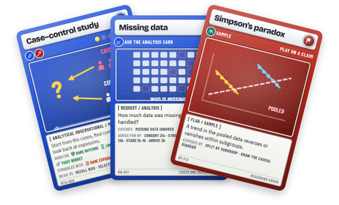

# SMART-Lab Science Game Kit

**Card games that help researchers refresh their research-methods knowledge.** Each game takes one moment in the life
of a study. All are free to play in the browser, or to print and cut for a class or a lab meeting.

**[Open the kit: ua-smartlab.github.io/science-game-kit](https://ua-smartlab.github.io/science-game-kit/)**

| | Game | You… | You practise | Play |
|---|---|---|---|---|
| 1 | [Methodical](https://github.com/UA-SMARTLab/methodical-card-game) | plan the study: pick the method that can answer a research problem, then defend it against a bias | study designs, threats to validity, safeguards | [Play](https://ua-smartlab.github.io/methodical-card-game/app/) |
| 2 | [Major Revisions](https://github.com/UA-SMARTLab/major-revisions-card-game) | review the manuscript: find the flaw planted in it with the right reviewer requests | reporting guidelines and the flaws they catch | [Play](https://ua-smartlab.github.io/major-revisions-card-game/app/) |
| 3 | [Red Flag](https://github.com/UA-SMARTLab/red-flag-card-game) | judge the claim: flag its reasoning error, or call it sound | confounding, sampling, statistical and publication errors | [Play](https://ua-smartlab.github.io/red-flag-card-game/app/) |



## How this repository is built

This repository is only the kit's front door: one hand-written page, `index.html`, with no build step. Each game lives
in its own repository with its own data, build, tests and web page, and links back here.

The cards on the page are pictures of the real cards, rendered from each game's print sheets so they never drift
from the game. After a game's cards change, rebuild that game, then with the game folders next to this one:

```sh
python tools/card_images.py ../methodical-card-game ../major-revisions-card-game ../red-flag-card-game
```

The cards shown are listed in `SHOWCASE` at the top of `tools/card_images.py`; `python tools/card_images.py --fan` then
redraws `assets/kit-fan.png`, the picture used in READMEs. The kit's shared conventions (card
look, app behaviour, content rules) are in [Methodical's CLAUDE.md](https://github.com/UA-SMARTLab/methodical-card-game/blob/main/CLAUDE.md).

## Licence

© 2026 Abdulhamid Baghdadi, SMART-Lab, Universiteit Antwerpen. Free for non-commercial use: teaching, study, research
and play. Content under [CC BY-NC-SA 4.0](https://creativecommons.org/licenses/by-nc-sa/4.0/), software under the
[PolyForm Noncommercial License 1.0.0](https://polyformproject.org/licenses/noncommercial/1.0.0/). Selling the games
or making merchandise from them needs written permission. Details in [`LICENSE.md`](LICENSE.md).
